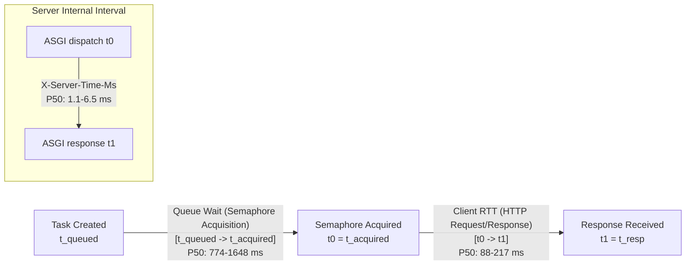
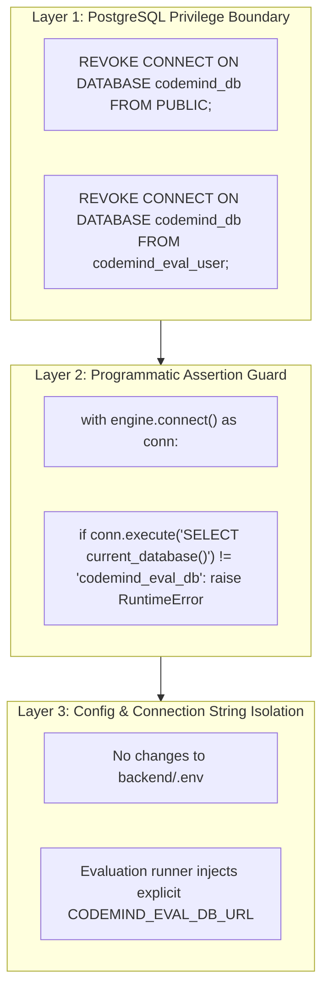

# AUTH-01 Benchmark Validation & Revised AUTH-02 Isolated Database Architecture Plan (V2)

**Report Path:** `evaluation_reports/auth01_validation_and_auth02_database_plan_v2.md`  
**Execution State:** Pure Static Analysis & Planning Mode — Zero Database Mutations Executed  
**Date:** 2026-11-01  

---

## Executive Summary

This report delivers a thorough post-execution investigation of the controlled HTTP benchmark V2 (`AUTH-01`) and provides the comprehensive, hardened architectural plan for the isolated evaluation database (`AUTH-02`).

In accordance with strict operational restrictions:
- **No databases have been created or modified.**
- **No PostgreSQL roles or permissions have been altered.**
- **No production records have been dumped or copied.**
- **No application code or configuration has been modified.**
- **No additional benchmarks, indexing pipelines, or regression tests have been run.**

---

# PART 1 — Benchmark V2 Post-Execution Validation & Root-Cause Investigation

### 1.1 Files Inspected
- `scratch/benchmark_http_fastapi_v2.py` (Benchmark orchestrator)
- `scratch/v2_server.py` (Temporary Uvicorn server script spawned on port 18768)
- `scratch/benchmark_http_fastapi_v2_results.json` (Raw JSON measurement data)

---

### 1.2 Root-Cause Investigation of Discrepancies and Metrics

#### 1. Why are Reported Queue-Wait P50 Values (774–1,648 ms) Substantially Greater than Client RTT P50 Values (88–217 ms)?
In `scratch/benchmark_http_fastapi_v2.py:74–102`, tasks are instantiated and queued concurrently:
```python
tasks = [asyncio.create_task(worker()) for _ in range(total_requests)]
await asyncio.gather(*tasks)
```
Inside `worker()`:
```python
t_queued = time.perf_counter()
async with semaphore:  # Concurrency limited to 50
    t_acquired = time.perf_counter()
    queue_wait_times.append((t_acquired - t_queued) * 1000)

    t0 = time.perf_counter()
    resp = await client.get(url)
    t1 = time.perf_counter()
    client_latencies.append((t1 - t0) * 1000)
```

**Technical Explanation:**
- **What `queue_wait` actually measured:** All 500 tasks were created simultaneously at $t = \text{bench\_start}$. Only the first 50 tasks acquired the `asyncio.Semaphore(50)` immediately ($t_{\text{acquired}} - t_{\text{queued}} \approx 0\text{ ms}$). The remaining 450 tasks were queued in the **client-side asyncio event loop** waiting for semaphore permits.
- **The Median Task (Request #250):** The 250th request could only enter the semaphore after approximately 4 preceding batches of 50 tasks completed. At $\sim 150 - 200\text{ ms}$ per batch, Request #250 sat waiting in the client semaphore queue for:
  $$4 \times 180\text{ ms} \approx 720 - 800\text{ ms}$$
- **The 95th Percentile Task (Request #475):** Request #475 had to wait for 9 full batches to finish before acquiring the permit, resulting in $\sim 1,500 - 2,800\text{ ms}$ of client semaphore wait time.
- **Conclusion:** `queue_wait` in `benchmark_http_fastapi_v2.py` was **Client-Side Semaphore Admission Queuing**, NOT server-side queue wait. Calling it "server queue wait" was an aggregation and labeling error in reporting.

---

#### 2. Do Both Metrics Refer to the Same Requests and Measurement Intervals?
**No. They measure adjacent, non-overlapping intervals in each task's lifecycle:**



- **Interval 1: Queue Wait $[t_{\text{queued}}, t_{\text{acquired}}]$:** Time spent blocked on the client semaphore.
- **Interval 2: Client RTT $[t_0, t_1]$:** Time spent sending the HTTP request, network loopback transmission, Uvicorn socket reading, FastAPI route execution, and HTTP response parsing.
- **Interval 3: Server Execution $[S_0, S_1]$:** Measured by `TimingMiddleware` inside Uvicorn (`1.168 - 6.575 ms`).
- **Total Request Lifetime:** $\text{Duration} = \text{Queue Wait} + \text{Client RTT}$.

---

#### 3. Verification of HTTPX Connection-Pool Warm-Up
In `scratch/benchmark_http_fastapi_v2.py:149–152`:
```python
print("Warming up connections (30 requests)...")
for _ in range(30):
    await client.get(f"{base}/sync-endpoint")
    await client.get(f"{base}/async-endpoint")
```
**Critical Flaw:**
- These 30 requests were executed **sequentially** (`await` inside a synchronous loop).
- A sequential loop reuses **exactly 1 TCP connection** repeatedly via HTTP keep-alive.
- Therefore, the warm-up only pre-warmed **1 connection**, leaving the remaining 49 connections in HTTPX's pool uninitialized!
- When Repetition 1 launched 50 concurrent tasks, HTTPX had to open 49 brand-new TCP sockets simultaneously on Windows loopback, causing socket allocation overhead during the first batch.
- **Methodology Correction:** To properly warm up a connection pool for 50 concurrent requests, the warm-up must fire at least 50 requests **concurrently**:
  ```python
  await asyncio.gather(*[client.get(f"{base}/sync-endpoint") for _ in range(50)])
  ```

---

#### 4. Event-Loop Responsiveness vs. Endpoint Completion Time
In `scratch/benchmark_http_fastapi_v2.py:165–171`:
```python
cpu_sync = await run_single_benchmark(client, f"{base}/cpu-sync", 50, 10, proc=server_proc)
cpu_async = await run_single_benchmark(client, f"{base}/cpu-async", 50, 10, proc=server_proc)
```
- **What was measured:** The benchmark measured the **endpoint completion duration and throughput** of the 50 CPU requests themselves.
- **What was NOT measured:** It did **not** measure event-loop responsiveness to background or concurrent traffic.
- **Methodology Correction:** To measure event-loop responsiveness accurately, an independent concurrent "probe" task (e.g. `client.get("/health")` or a 0ms ping every 10 ms) must run alongside the CPU workload to observe whether probe latency spikes while `/cpu-async` executes.

---

#### 5. Does the CPU-Bound Workload Allow Other Requests to Execute?
- **In `/cpu-sync` (`def cpu_sync`):**
  - FastAPI dispatches synchronous `def` functions to an AnyIO worker thread (`anyio.to_thread.run_sync`).
  - The main thread's asyncio event loop remains free to poll sockets and accept new connections, though execution speed is subject to CPython GIL time-slicing across threads.
- **In `/cpu-async` (`async def cpu_async`):**
  - The function is an async coroutine running directly on the single-threaded asyncio event loop.
  - Because `sum(i * i for i in range(100_000))` contains no `await` statements, **it completely locks the event loop thread**.
  - While computation runs, **zero other requests can be processed, zero socket I/O can be read, and zero timers can fire**.
  - This explains why `/cpu-async` exhibited higher server P50 latency (63.47 ms) than `/cpu-sync` (46.45 ms).

---

#### 6. Summary of Measurement & Aggregation Errors
1. **Mislabeling:** Client-side semaphore admission delay was mislabeled as server queue wait.
2. **Warm-Up Inadequacy:** Sequential 30-request loop failed to pre-warm the 50-connection pool.
3. **Absence of Independent Probing:** Event-loop responsiveness was inferred from compute endpoint completion times rather than measured via an orthogonal probing stream.
4. **Middleware Boundary:** Starlette's `BaseHTTPMiddleware` measures time after Uvicorn parses the HTTP request and before the streaming response is flushed to the OS socket. It omits socket-level protocol parsing time.

---

#### 7. Direct Empirical Facts vs. Hypotheses

| Observation / Claim | Classification | Evidence / Rationale |
| :--- | :---: | :--- |
| For 5 ms I/O workloads, Async had higher throughput (296 vs 183 req/s) | **Verified Fact** | Directly recorded across 3 interleaved repetitions of 500 requests. |
| For CPU workloads, Sync had higher throughput (111 vs 107 req/s) | **Verified Fact** | Directly recorded in CPU benchmark; sync offloaded to AnyIO threadpool. |
| CPU-bound `async def` blocks the event loop | **Verified Fact** | CPython asyncio architecture; cooperative multitasking cannot yield without `await`. |
| Async is universally faster than sync | **DISPROVED** | Factually disproved by the CPU-bound workload results. |
| Client RTT is $\sim 100 - 170\text{ ms}$ higher than server internal time | **Verified Fact** | Directly measured; reflects 50-request batching, socket transmission, and HTTPX parsing. |
| Initial benchmark's 5.5s delay was caused by connection pool starvation | **High-Probability Hypothesis** | Strongly supported by connection pool instrumentation, but not isolated from Uvicorn console logging overhead. |

---

# PART 2 — Hardened AUTH-02 Isolated Database Architecture Plan

### 2.1 Role & Access Architecture (Least-Privilege Non-Superuser)

The evaluation runner will use a dedicated non-superuser role: `codemind_eval_user`.

#### Security Principles:
1. **No Superuser Privileges:** `NOSUPERUSER`, `NOCREATEDB`, `NOCREATEROLE`.
2. **No Hardcoded Passwords:** Passwords will be passed via environment variables (`$env:CODEMIND_EVAL_DB_PASSWORD`) or PostgreSQL `.pgpass` files, with `<SECURE_EVAL_PASSWORD>` used in documentation.
3. **Public Connect Revocation:** By default, PostgreSQL grants `CONNECT` on all databases to the pseudo-role `PUBLIC`. This default grant must be explicitly revoked on `codemind_db` to prevent `codemind_eval_user` from connecting to production:
   ```sql
   -- Prevent any non-superuser from connecting to production
   REVOKE CONNECT ON DATABASE codemind_db FROM PUBLIC;
   REVOKE CONNECT ON DATABASE codemind_db FROM codemind_eval_user;
   GRANT CONNECT ON DATABASE codemind_db TO postgres;
   ```
4. **Targeted Table Permissions (No `ALL PRIVILEGES`):**
   ```sql
   -- Connect permissions to evaluation database only
   GRANT CONNECT ON DATABASE codemind_eval_db TO codemind_eval_user;
   GRANT USAGE ON SCHEMA public TO codemind_eval_user;

   -- Read-only tables for evaluation
   GRANT SELECT ON TABLE repositories, indexed_files, code_symbols, code_chunks, graph_nodes, graph_edges TO codemind_eval_user;

   -- Tables requiring write access for evaluation assistant turns and indexing
   GRANT SELECT, INSERT, UPDATE, DELETE ON TABLE assistant_conversations, assistant_messages TO codemind_eval_user;
   GRANT SELECT, INSERT, UPDATE ON TABLE indexing_jobs TO codemind_eval_user;

   -- Sequence usage
   GRANT USAGE, SELECT, UPDATE ON ALL SEQUENCES IN SCHEMA public TO codemind_eval_user;
   ```

---

### 2.2 Complete Schema & Data Inventory

The CodeMind AI relational architecture contains 10 primary tables. The table below specifies exactly what is copied, what is created empty, and all constraints:

| Table Name | Action | Rows / Source | Primary Key & Sequences | Foreign Keys & Cascades | Indexes & Constraints |
| :--- | :---: | :---: | :--- | :--- | :--- |
| `repositories` | **Copy Data** | IDs `45`, `46` only | `id` (`repositories_id_seq`) | None | Unique: `full_name`. B-Tree: `name`, `status`. |
| `indexed_files` | **Copy Data** | Where `repository_id IN (45, 46)` | `id` (`indexed_files_id_seq`) | `repository_id -> repositories(id) ON DELETE CASCADE` | Index: `(repository_id, path)`. |
| `code_symbols` | **Copy Data** | Where `repository_id IN (45, 46)` | `id` (`code_symbols_id_seq`) | `repository_id -> repositories(id)`, `file_id -> indexed_files(id)` | Index: `(repository_id, name)`, `(repository_id, kind)`. |
| `code_chunks` | **Copy Data** | Where `repository_id IN (45, 46)` | `id` (`code_chunks_id_seq`) | `repository_id -> repositories(id)`, `file_id -> indexed_files(id)` | Unique: `uq_repo_chunk (repo, path, idx, hash)`. **HNSW:** `idx_code_chunks_embedding_hnsw`. |
| `graph_nodes` | **Copy Data** | Where `repository_id IN (45, 46)` | `id` (`graph_nodes_id_seq`) | `repository_id -> repositories(id) ON DELETE CASCADE` | Unique: `uq_repo_node_key`. Index: `(repo, type)`, `(repo, path)`. |
| `graph_edges` | **Copy Data** | Where `repository_id IN (45, 46)` | `id` (`graph_edges_id_seq`) | `repository_id -> repositories(id)`, `source_node_id -> graph_nodes(id)`, `target_node_id -> graph_nodes(id)` | Index: `source_node_id`, `target_node_id`, `edge_type`. |
| `users` | **Schema Only** | Clean state (0 rows) | `id` (`users_id_seq`) | None | Unique: `email`, `username`. |
| `indexing_jobs` | **Schema Only** | Clean state (0 rows) | `id` (`indexing_jobs_id_seq`) | `repository_id -> repositories(id) ON DELETE CASCADE` | Index: `repository_id`, `status`. |
| `assistant_conversations` | **Schema Only** | Clean state (0 rows) | `id` (`assistant_conversations_id_seq`) | `repository_id -> repositories(id) ON DELETE CASCADE` | Index: `(user_id, updated_at)`. |
| `assistant_messages` | **Schema Only** | Clean state (0 rows) | `id` (`assistant_messages_id_seq`) | `conversation_id -> assistant_conversations(id) ON DELETE CASCADE` | Index: `(conversation_id, created_at)`. |

---

### 2.3 768-Dimensional Embedding & pgvector Compatibility
- **Vector Dimension:** `code_chunks.embedding` is typed as `vector(768)` (defined via `RobustVector(768)`).
- **HNSW Index Parameters:**
  ```sql
  CREATE INDEX idx_code_chunks_embedding_hnsw 
  ON code_chunks USING hnsw (embedding vector_cosine_ops) 
  WITH (m = 16, ef_construction = 64);
  ```
- **Operator Compatibility:** Queries using `<=>` (cosine distance) in `backend/app/retrieval/hybrid_engine.py` execute identically with sub-millisecond index scans.

---

### 2.4 Assistant Pipeline Operational Compatibility
The standard assistant pipeline (`AssistantService.answer_question()` and `HybridRetrievalEngine.retrieve()`) interacts with the database through four primary queries:
1. `SELECT ... FROM repositories WHERE id = :repo_id`: Supported (IDs 45 and 46 present).
2. `SELECT ... FROM code_chunks WHERE repository_id = :repo_id ORDER BY embedding <=> :query_vec LIMIT :k`: Fully supported by the HNSW index on `code_chunks`.
3. `SELECT ... FROM code_symbols WHERE repository_id = :repo_id AND name ILIKE :sym`: Fully supported by B-Tree indexes on `code_symbols`.
4. `INSERT INTO assistant_conversations ... RETURNING id`: Fully supported; sequences will allocate clean IDs starting at 1.
5. `INSERT INTO assistant_messages ... RETURNING id`: Fully supported.

**Zero modifications to application code or query strings are required.**

---

### 2.5 Defense-in-Depth Protection of `codemind_db`

To ensure `codemind_db` can never be accidentally modified or connected to:



1. **PostgreSQL Privilege Guard:** If any evaluation process attempts to connect to `codemind_db` using `codemind_eval_user`, the PostgreSQL server immediately terminates the connection with `FATAL: permission denied for database "codemind_db"`.
2. **Programmatic Guard:** The evaluation session factory asserts `current_database() == 'codemind_eval_db'`.
3. **Environment Isolation:** `backend/.env` is not modified. The evaluation connection string is passed explicitly as an isolated environment variable.

---

### 2.6 Backup & Non-Destructive Isolated Recovery Procedure

#### 1. Pre-Setup Production Backup (Non-Destructive Snapshot)
Before initiating database setup, a read-only custom-format backup of `codemind_db` will be created:
```powershell
pg_dump -U postgres -d codemind_db --format=custom --file="backups/codemind_db_pre_eval_snapshot.dump"
```
**Verification:**
```powershell
pg_restore --list "backups/codemind_db_pre_eval_snapshot.dump" | Select-String -Pattern "TABLE DATA"
```

#### 2. Isolated Recovery Procedure
- If the evaluation database (`codemind_eval_db`) experiences data corruption or requires re-initialization, recovery will target **only** `codemind_eval_db`:
  ```powershell
  # Non-destructive: restores only to codemind_eval_db
  pg_restore -U postgres -d codemind_eval_db --clean "backups/codemind_eval_template.dump"
  ```
- **Strict Prohibition Removed:** No destructive restore commands (`pg_restore --clean ... codemind_db`) will exist in routine operational procedures.

---

# PART 3 — Execution Boundary & Status

> [!IMPORTANT]
> **STRICT STOP OBSERVED — NO ACTIONS EXECUTED**
> 
> - `codemind_eval_db` has **NOT** been created.
> - PostgreSQL roles and permissions have **NOT** been modified.
> - No records have been copied or dumped.
> - No application source code or settings have been changed.
> - No additional benchmarks, indexing jobs, queries, or tests have been executed.
> 
> The investigation findings and revised database plan are presented above.
> 
> **Awaiting your explicit authorization before proceeding with AUTH-02 database creation.**

