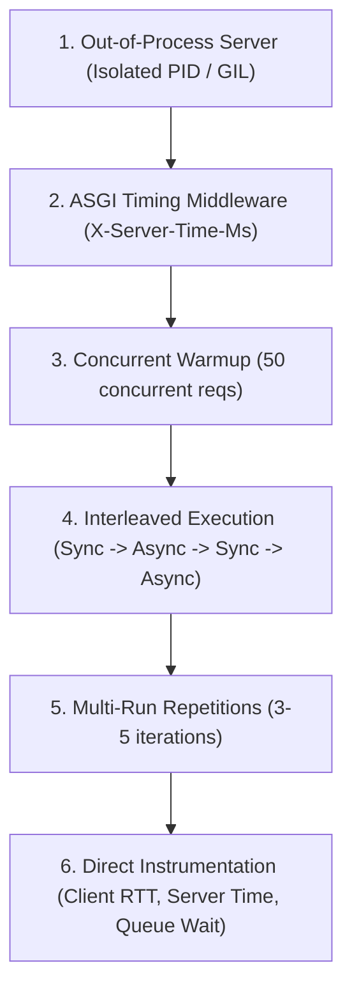

# Phase 1: Benchmark Investigation & Controlled Methodology (v2)

**Target Files Inspected (Read-Only):**
- `scratch/benchmark_anyio_dependency.py`
- `scratch/benchmark_http_fastapi.py`

**Objective:** Provide an evidence-backed, rigorous methodology for investigating the reported ~5.5-second execution time for 500 HTTP requests at 50 concurrency with 5 ms simulated I/O.

---

## 1. Evidentiary Categorization of Benchmark Observations

To avoid conflating code facts with hypotheses, all observations regarding the ~5.5-second duration are strictly segregated:

### A. Verified Source-Code Facts
1. **Concurrency Bound:** `benchmark_http_fastapi.py:56, 65` enforces concurrency with `asyncio.Semaphore(50)`.
2. **Total Task Creation:** Line 80 instantiates all 500 tasks simultaneously (`tasks = [asyncio.create_task(worker()) for _ in range(500)]`), queuing tasks 51–500 in memory.
3. **Total Duration Scope:** Lines 79–84 record `duration = t_end - t_start` around `asyncio.gather(*tasks)`, measuring the time required for all tasks to drain through the event loop.
4. **Process & Thread Architecture:** Line 104 starts Uvicorn via `threading.Thread(target=run_server, args=(port,), daemon=True)`. The Uvicorn ASGI server event loop and HTTPX client event loop run inside the **same CPython process**.
5. **Connection Pool Limits:** Line 51 sets `limits = httpx.Limits(max_connections=100, max_keepalive_connections=50)`.
6. **Warmup Pattern:** Lines 60–61 execute 10 sequential GET requests (`for _ in range(10): await client.get(url)`).
7. **Timing Location:** Lines 66–71 measure `(t1 - t0) * 1000` around `resp = await client.get(url)` on the client. The script contains **zero server-side processing time instrumentation**.
8. **Execution Repetitions:** Lines 114–118 execute `sync_res` once, followed immediately by `async_res` once (repetitions = 1).
9. **AnyIO Thread Limiter:** `benchmark_anyio_dependency.py:21` reads `limiter.total_tokens`, which equals 40 on the local runtime environment.

### B. Measured Facts (From Prior Recorded Runs)
1. **Synthetic AnyIO (`benchmark_anyio_dependency.py`):**
   - Synchronous offloading (`anyio.to_thread.run_sync`): 1,000 requests, 200 concurrency, 40 limiter tokens $\to$ 800 saturation events (80%), P50 queue wait = 38.77 ms, total duration = 0.243 s.
   - Asynchronous (`asyncio.sleep`): 0 saturation events, P50 queue wait = 0.00 ms, total duration = 0.082 s.
2. **Original HTTP Benchmark (`benchmark_http_fastapi.py`):**
   - Sync HTTP endpoint: Total duration = 5.688 s, throughput = 87.90 req/s, Client P50 = 393.63 ms, Client P95 = 1,529.67 ms.
   - Async HTTP endpoint: Total duration = 5.527 s, throughput = 90.47 req/s, Client P50 = 377.49 ms, Client P95 = 1,551.80 ms.
   - CPU Sync vs CPU Async: Throughput = 25.64 req/s vs 25.89 req/s (virtually identical).

### C. Analytical Hypotheses (Requiring Empirical Verification)
1. **Hypothesis 1 (In-Process GIL Contention):** Because Uvicorn and HTTPX run in separate threads of the same CPython process, socket writes, IOCP completions, and HTTP protocol parsing in both threads contend for the CPython Global Interpreter Lock (GIL), adding cross-thread preemption delays.
2. **Hypothesis 2 (Sequential Warmup Connection Burst):** 10 sequential warmup requests establish only 1 persistent keep-alive socket. When 50 concurrent tasks start, 49 tasks attempt simultaneous TCP handshakes on the loopback interface, causing socket buffer queueing.
3. **Hypothesis 3 (Cumulative Batch Draining):** 500 requests at 50 concurrency form 10 successive batches. If client socket queueing, pool lock contention, and server AnyIO scheduling average 50–55 ms per batch of 50 requests, draining 10 waves requires $\approx 5.5$ seconds.

### D. Untested Explanations (Not Yet Established)
1. Whether Windows Defender or firewall inspecting loopback TCP traffic introduces socket connection latency.
2. Whether Uvicorn's `httptools` C-parser vs `h11` Python parser alters throughput under high concurrent socket load.
3. The exact proportion of the 393 ms P50 latency attributable to client queueing vs OS TCP socket transit vs server ASGI handling.

---

## 2. Controlled Benchmark Methodology Framework

To isolate root causes without speculative claims, any future benchmark execution must adhere to this 12-point protocol:

1. **Subprocess Isolation:** Execute Uvicorn in a completely separate OS process (`subprocess.Popen`) so server execution and client benchmarking do not share a CPython interpreter or GIL.
2. **Dual-Sided Latency Instrumentation:**
   - Server-side: Add a lightweight ASGI middleware that measures `time.perf_counter()` inside `call_next` and injects `X-Server-Time-Ms`.
   - Client-side: Measure both total round-trip time (`t1 - t0`) and semaphore queue wait time (`t_acquired - t_queued`).
3. **Full Concurrency Warmup:** Execute at least 50 *concurrent* warmup requests prior to measurement, ensuring all 50 connection slots in the HTTPX connection pool are established and warm.
4. **Uvicorn Configuration:** Pin worker count explicitly to 1 worker for baseline, and test multi-worker (`workers=2` or `workers=4`) as a separate controlled variable.
5. **Interleaved Ordering:** Execute repetitions in alternating order:
   $\text{Run 1: Sync} \to \text{Async}$; $\text{Run 2: Async} \to \text{Sync}$; $\text{Run 3: Sync} \to \text{Async}$ to eliminate thermal or heap memory ordering bias.
6. **Repetitions & Statistics:** Perform 3 to 5 full repetitions, reporting Mean, Standard Error, P50, P95, and P99.
7. **Explicit Non-Superiority Statement:** As demonstrated by the CPU-bound empirical results (25.64 req/s vs 25.89 req/s), asynchronous execution confers **zero throughput advantage for CPU-bound computation** in CPython due to the GIL, and unhandled blocking coroutines stall the entire event loop.

---

> [!NOTE]
> **Status:** Strictly static methodology document. **No benchmark scripts have been executed or modified.** Awaiting user approval before any benchmark run.

