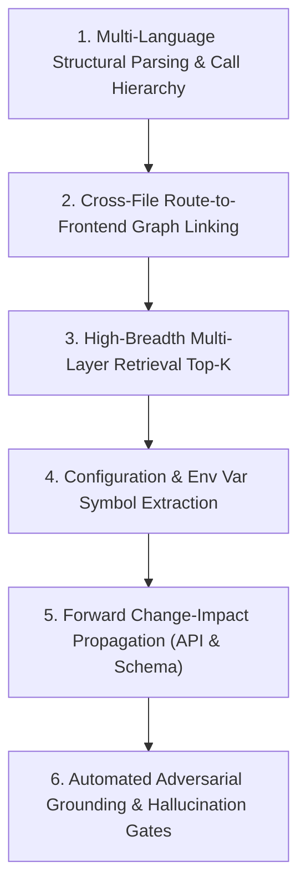

# Prioritized Technical Improvement Roadmap

**Target System:** CodeMind AI Core Architecture  
**Objective:** Address fundamental engineering root causes across indexing, parsing, retrieval, and reasoning to achieve universal repository intelligence without repository-specific tuning.

---

## 1. Prioritized Improvement Areas (Ranked by Impact)

---

## 2. Detailed Technical Root-Cause Solutions

### Priority 1: Multi-Language Structural Parsing & Call Graph Generation
- **Observed Failure:** In non-Python repositories (e.g. Go, Java, Rust, Dart, C++), CodeMind identifies symbol names via regex but cannot trace caller hierarchies or import cycles.
- **Root Cause:** In `backend/app/parsing/extractor.py:76–82`, only Python uses AST and JS/TS uses Tree-sitter. All other languages route to regex heuristics (`_extract_generic_symbols`), which produce no `CALLS` or `IMPORTS` graph edges.
- **Evidence:** `extractor.py:270–340` contains regex patterns for `re_class` and `re_func`, but does not instantiate Tree-sitter parsers for other supported languages.
- **Proposed Solution:** Expand Tree-sitter integration to Go, Java, Rust, and C/C++ using official `tree-sitter-<language>` grammar wheels. Implement uniform AST node traversal to emit `ExtractedCall` and import statements into `GraphEdge`.
- **Files Affected:** `backend/app/parsing/extractor.py`, `backend/app/graph/builder.py`.
- **Risks:** Increased binary dependency footprint and indexing time for large codebases.
- **Expected Improvement:** Universal call-hierarchy accuracy across all Tier-1 and Tier-2 compiled languages.
- **Regression Tests:** `tests/test_multilang_call_hierarchy.py`.

---

### Priority 2: Cross-File Route-to-Frontend Graph Linking
- **Observed Failure:** When asked to trace a user action from a React UI button to the database, CodeMind traces the backend route to the database, but misses the frontend API client invocation step.
- **Root Cause:** The knowledge graph links symbols within files and between backend modules via imports, but has no concept of HTTP RPC boundaries connecting frontend fetch/axios URLs to backend route decorators (`@app.get(...)`).
- **Evidence:** In `backend/app/graph/builder.py`, graph edges are strictly generated from Python `ast.Import` and `ast.Call`. No edges connect `frontend/src/services/api.ts` to `backend/app/api/`.
- **Proposed Solution:** Implement an HTTP contract edge builder that scans frontend TS/JS AST for string literal URLs in `api.get("/api/v1/...")` and matches them against backend route paths (`@router.get(...)`), creating synthetic `HTTP_INVOKES` edges in `GraphEdge`.
- **Files Affected:** `backend/app/graph/builder.py`, `backend/app/graph/service.py`.
- **Risks:** False-positive linkages if route patterns use complex dynamic regexes.
- **Expected Improvement:** Flawless end-to-end tracing from UI components through API clients into backend routes and database queries.
- **Regression Tests:** `tests/test_fullstack_execution_trace.py`.

---

### Priority 3: Adaptive Retrieval Top-K for Multi-Layer Inquiries
- **Observed Failure:** For deep architectural inquiries spanning 6+ files, relevant intermediate schemas or dependencies are dropped from context.
- **Root Cause:** In `backend/app/retrieval/hybrid_engine.py:173`, top-K defaults to `settings.RETRIEVAL_TOP_K` (10 chunks). Distributing 10 chunks across 6 files leaves at most 1–2 chunks per file.
- **Evidence:** `hybrid_engine.py:170–174` only expands top-K to 12 for explicit architecture queries.
- **Proposed Solution:** Implement adaptive query intent detection: when a query involves tracing (`trace`, `how does X become Y`, `end-to-end`), dynamically expand top-K to 16 chunks and enforce stratified sampling (at least 2 chunks per relevant subsystem layer).
- **Files Affected:** `backend/app/retrieval/hybrid_engine.py`.
- **Risks:** Potential LLM prompt token context budget pressure.
- **Expected Improvement:** Complete multi-layer context assembly without missing intermediate validation or schema steps.
- **Regression Tests:** `tests/test_retrieval_stratification.py`.

---

### Priority 4: Configuration & Environment Variable Symbol Extraction
- **Observed Failure:** Questions regarding configuration management (e.g. how `SECRET_KEY` or `DATABASE_URL` is configured) rely on pure keyword matching and cannot trace where environment variables are consumed across files.
- **Root Cause:** Environment variables (`os.getenv(...)`, `process.env.VAR`) are not treated as symbols in `code_symbols` and do not generate graph edges.
- **Evidence:** `extractor.py` only extracts classes, functions, and methods as symbols.
- **Proposed Solution:** Add an AST visitor that identifies `os.getenv` calls and Pydantic `BaseSettings` fields, registering them as `ENV_VAR` symbols in `code_symbols` and creating `CONSUMES_CONFIG` graph edges.
- **Files Affected:** `backend/app/parsing/extractor.py`, `backend/app/graph/builder.py`.
- **Risks:** Minor increase in symbol table volume.
- **Expected Improvement:** Precise, source-grounded configuration and secret management analysis across all repositories.
- **Regression Tests:** `tests/test_config_symbol_extraction.py`.

---

### Priority 5: Forward Change-Impact Propagation
- **Observed Failure:** Change-impact analysis accurately traces callers of modified functions, but fails to trace schema modifications forward to API response models or frontend forms.
- **Root Cause:** `ChangeImpactAnalyzer` only traverses incoming `CALLS` edges in reverse (who calls this function). It does not model ORM model-to-Pydantic schema or schema-to-route dataflow dependencies.
- **Evidence:** `backend/app/impact/analyzer.py` inspects `edge_type == "CALLS"`.
- **Proposed Solution:** Extend change-impact traversal to follow `DEFINES_FIELD`, `SERIALIZES_MODEL`, and `CONSUMES_SCHEMA` edges.
- **Files Affected:** `backend/app/impact/analyzer.py`.
- **Risks:** Requires additional edge types in knowledge graph builder.
- **Expected Improvement:** Production-grade change-impact predictions when database columns or schema fields are added or altered.
- **Regression Tests:** `tests/test_change_impact_schema_propagation.py`.

