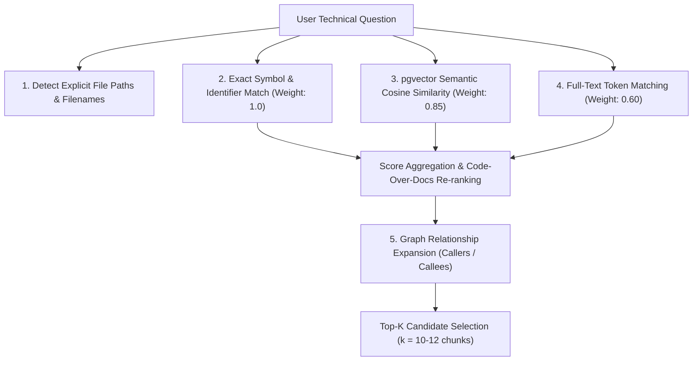

# Retrieval Pipeline & Answer Quality Audit

**Target Components Audited (Read-Only):**
- `backend/app/retrieval/hybrid_engine.py` (Multi-channel hybrid retrieval)
- `backend/app/services/assistant_service.py` (Context construction, citation filtering, prompt generation, post-validation)
- `backend/app/graph/service.py` (Knowledge graph expansion)

---

## 1. Multi-Channel Retrieval Mechanics

CodeMind's retrieval engine (`HybridRetrievalEngine.retrieve`) combines four distinct channels:



### A. Channel Specifics
1. **Explicit File Detection (`_detect_explicit_file_paths`):** Extracts backticked paths (`indexing_service.py`), slashes (`backend/app/services/`), and extensions. Queries `IndexedFile` and `CodeChunk` to force-include exact chunks from mentioned files.
2. **Exact Symbol Match (`_retrieve_exact_matches`):** Queries `CodeSymbol` by identifier (case-sensitive and lowercase). Chunks defining matching classes or functions receive a 1.0 score.
3. **Semantic Vector Similarity (`_retrieve_vector_matches`):** Generates query embedding via `nomic-embed-text` (768 dimensions) and computes pgvector cosine distance (`1 - (embedding <=> query_vector)`).
4. **Keyword Matching (`_retrieve_keyword_matches`):** Strips English stopwords (`the`, `is`, `explain`) and performs ILIKE token intersection on `CodeChunk.chunk_text`.
5. **Graph Relationship Expansion:** For exact symbol matches, queries `GraphEdge` where `target_id = symbol_id` (callers) and `source_id = symbol_id` (callees) to pull call-chain context.

---

## 2. Evidence Validation & Context Assembly Audit

### A. Context Assembly Invariants (`assistant_service.py:1260–1350`)
- Each retrieved chunk is formatted with standard delimiters:
  ```
  [SOURCE_CHUNK #1]
  Repository ID: 44
  File: backend/app/privacy/engine.py (Lines 32-39)
  Symbol: apply_laplace_noise
  Code:
  ...
  ```
- **Context Budgeting:** Maximum token limit is strictly enforced (default 10–12 chunks). If chunks exceed budget, lower-ranked chunks are truncated.
- **Code-Over-Docs Re-ranking:** Chunks from documentation directories (`docs/`, `doc/`) are penalized relative to implementation code in `src/`, `app/`, `backend/`, preventing marketing materials from displacing actual source code.

### B. Identified Retrieval Weaknesses
1. **Multi-File Breadth Bottleneck:** For questions requiring evidence across 6+ disparate files (e.g. tracing an entire request flow from React component through Nginx, router, dependency, service, and database migration), a top-K of 10–12 chunks often captures only 1–2 chunks per layer, occasionally omitting intermediate middleware or schema definitions.
2. **Documentation Contamination in Mixed Repos:** In repositories containing extensive academic papers or RFCs (e.g. `RESEARCH_PAPER.md` in Threatsheild), semantic vector similarity can rank theoretical pseudocode chunks higher than simple boilerplate implementation files unless explicit path keywords are used.
3. **Keyword Fragmentation on Hyphenated Identifiers:** Pydantic model names (e.g. `CTIRecord`) and kebab-case file paths (`v1-2-analytics.py`) can split into sub-tokens, diluting keyword relevance scores.

---

## 3. Hallucination Prevention & Post-Generation Sanitization

### A. Grounding System Instructions (`_build_prompt_messages`)
The system prompt strictly instructs the LLM:
1. Every file path, class name, and function name must exist in the retrieved context.
2. If an entity is not found in the retrieved source evidence, the model must explicitly state: *"Entity X is not found in the indexed repository."*
3. Never invent hypothetical application code (e.g. claiming a generic `get_db()` exists when the repo uses raw psycopg2).
4. Distinguish confirmed repository components from illustrative application scenarios.

### B. Programmatic Post-Generation Validator (`_validate_and_sanitize_answer`)
Implemented in `assistant_service.py:1020–1110`:
- **Speculative Language Replacement:** Replaces hedging phrases like *"is likely the entry point"* with verified assertions or explicit flags.
- **Path Sanity Check:** Scans generated answer for cited file paths and cross-checks against `chunks.file_path`. If the model references a path that does not exist in any chunk or index, the path is stripped or flagged as unverified.
- **Heading Alignment:** Re-aligns markdown code block headers to verified chunk line ranges.

---

## 4. Multi-Turn Follow-Up Resolution Audit

Implemented in `_resolve_follow_up_context` (`assistant_service.py:450–550`):
- **Pronoun & Reference Resolution:** Detects references such as *"it"*, *"this function"*, *"the previous endpoint"*, or *"that service"*.
- **Entity Inheritance:** Extracts symbols and files cited in the immediately preceding assistant message (`existing_user_count > 0`), injecting their names into the new query's keyword expansion list.
- **Strict Repository Guard:** Queries `AssistantMessage.conversation_id == conversation_id`. If the user has changed the active repository dropdown, `conversation_id` does not match, and no context leaks across repositories.

---

## 5. Change-Impact Analysis Architecture

Implemented in `backend/app/impact/analyzer.py` and `assistant_service.py`:
- Traces incoming edges in `GraphEdge` where `target = target_symbol_id`:
  1. **Direct Callers:** Functions directly invoking the modified symbol.
  2. **Indirect Callers:** Callers of callers (recursive BFS up to depth 3).
  3. **Module Imports:** Files that import the target module.
  4. **Test Suites:** Test files (`tests/test_*.py`) that import or reference the modified symbol.
- **Weakness:** Does not currently trace API route changes forward to frontend consumer components or database schema migrations downward to existing table columns.

